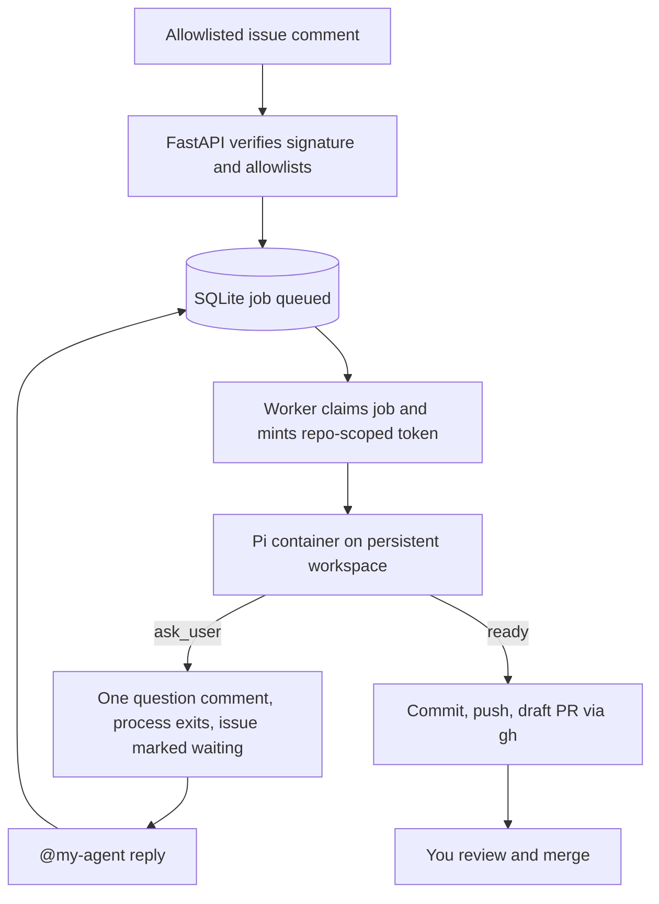

# Handoff — self-hosted GitHub issue agent

Last updated: after the first Pi build. Read `README.md` first; it contains the exact setup and manual test steps.

## Goal

When an allowlisted user comments `@my-agent implement …` on a GitHub issue, a self-hosted worker on the user's VM runs **Pi** headlessly. Pi edits code, runs checks, commits, pushes `agent/issue-N`, and opens or updates a draft PR. If blocked, Pi posts one batch of questions and exits. `@my-agent reply` resumes the same Pi session and checkout. The user reviews and merges manually. No GitHub Actions compute is used.

## Decisions already made

| Topic | Decision |
|---|---|
| Stack | Python 3.12 + FastAPI + SQLite, managed by **uv** (`uv sync --locked`, `uv run`). |
| Harness | **Pi first** (`pi` 1.5.2). Claude Code is planned next, not built. |
| Trigger | Explicit issue comment only (no auto-start on issue creation, no label trigger). |
| Task key | `(repository_id, issue_number)`. One Pi session ID stored per key, reused for replies. |
| Pause/resume | Pi `ask_user` extension posts one comment and ends the turn. Process exits. Reply launches a new process with the same session. |
| Permissions | Agent uses `git`/`gh`/`aws` directly (user's explicit choice). Python only authorizes, prepares the workspace, and resumes. |
| Isolation | Whole Pi process in Docker; only the issue workspace is mounted. |
| Athena | Deferred. Direct CLI planned with curated credentials; **no AWS creds are passed to the runner today**. |
| Approval | Human review required. Agent never merges. |

## What exists now

```
agent_worker/
  config.py      Env settings; strict ID parsing; webhook secret validation
  web.py         FastAPI: HMAC verification, event filtering, command parsing, enqueue
  queue.py       SQLite jobs + issue_tasks; claim/finish/mark_waiting/recover
  github.py      GitHub App JWT → short-lived repo-scoped installation token; revoke
  pi_runner.py   Docker command construction, prompt over stdin, JSONL event parsing
  worker.py      Single-process loop: lock, claim, token, run Pi, revoke
runner/
  Dockerfile     node:24-slim + gh, git, Pi 1.5.2
  run.sh         Clone or reuse workspace, branch `agent/issue-N`, verify origin, exec Pi
  ask-user.ts    ask_user tool: one `gh issue comment`, terminate turn, abort on mixed batch
  instructions.md Agent rules (branch/PR discipline, ask_user usage, no secrets)
tests/           webhook, queue/session, Pi event parsing, App token, real-CLI smoke
```

**Verified:** 19 tests pass including a real Pi CLI pause/resume with a fake provider and fake `gh` (`TEST_PI_CLI=1`). **Verified (2026-11-21):** `github-agent-pi:1.5.2` builds; the pause/resume smoke test passes inside the container with the worker's hardening flags (read-only root, cap-drop ALL, host UID). **Not verified:** `run.sh` clone/push against real GitHub, live GitHub App flow, real model. Note: the image ships Debian `gh` 2.23.0 (2023).

## Flow



## Key code facts to know before changing things

- `IssueJob`/`Run` fields: `delivery_id, installation_id, repository_id, issue_number, comment_id, requester_id, task, repository (full_name), kind ("implement"|"reply")`. `Run` adds `session_id`.
- Webhook accepts only `issue_comment` + `action=created`, issues (not PRs), user (not bot) author and sender, exact allowlisted installation/repo/requester. Task capped at 4096 chars; delivery ID must be a UUID.
- `queue.enqueue` returns `(status, job_id)`: `queued`, `duplicate`, `busy`, `not_waiting`, `waiting_for_reply`, or raises on DB failure.
- `queue.claim` creates the session ID on first claim of an issue and clears `waiting`. Only one worker may run (exclusive `flock` on a `.worker.lock` beside the DB).
- `recover_interrupted` marks `running` jobs failed and re-flags interrupted replies as waiting.
- `pi_runner.command` passes the model key via `--env NAME` (no value in argv), `GH_TOKEN` the same way, and the prompt via **stdin** so no user text is ever an argument. Container: `--rm --init --read-only --tmpfs /tmp --cap-drop=ALL --security-opt=no-new-privileges --pids-limit=256 --memory=2g --cpus=2 --log-driver=none`, host UID/GID on rootful Docker, `0:0` on rootless Docker (detected by `docker info` at worker startup; container root maps to the host user).
- `run.sh` requires `AGENT_REQUIRE_SESSION=1` for replies to resume by explicit session file; it refuses to silently create a new session.
- `PiEvents` requires the emitted session ID to match, records `waiting` once, and treats `agent_settled` as completion. Exit code must be 0.
- Pi runs with `--offline --no-approve --no-mcp --no-extensions --no-skills --no-prompt-templates` plus only our extension, so repo-local config can't inject tools/credentials.

## Open issues / next steps (in order)

1. **Manual VM test** (user's job): private disposable repo, GitHub App, protected default branch, build `github-agent-pi:1.5.2`, run web + worker, then the three-step README exercise. Confirm: question comment, worker log `waiting for reply`, restart persistence, resume with same session, draft PR.
2. **Verify `ctx.abort()` in `turn_end`** during the live test (targets a model that batches `ask_user` with other tools). If it doesn't stop cleanly, consider `executionMode`/tool-batch guards.
3. **Silent-no-PR detection:** success is currently "Pi completed a turn". Consider checking `gh pr list --head agent/issue-N` and marking the job failed/commenting if no draft PR exists.
4. **Stale-image guard:** if the runner image or Dockerfile changes, the mount to `/task` is the only persisted state; expect a fresh clone. Document/automate image rebuild.
5. **Disk retention:** workspaces + sessions grow forever; add cleanup for merged/closed issues.
6. **Claude Code backend:** second launcher behind the same queue; use `--print --output-format=stream-json --resume <id>` with the saved session ID. Question mechanism for Claude not yet designed (small `ask-user` script calling `gh`, ending the turn).
7. **Athena (optional):** curated creds injected only when enabled; workgroup scan limit, approved data only; never for the shared Codex account. Keep out of the default runner.
8. **Non-Claude provider note:** Pi supports OAuth profiles created locally (`~/.pi/agent/auth.json`), but this build only supports an API-key env var (`PI_PROVIDER_KEY_ENV`). Mounting an auth profile is a deliberate future decision, not an oversight.

## Constraints and warnings carried forward

- Do not connect the user's shared Codex account to GitHub. Do not enable private Athena data for it.
- Do not mount `~/.pi/agent`, the host home, or the Docker socket into the runner.
- The App token can read/write the whole repo for the job's duration; branch protection is the merge control. Consider limiting protected-branch updates to human maintainers.
- Agent containers can reach whatever the Docker network allows; metadata-service and private-service access was **not** firewall-scoped by this code. Do that on the VM.
- Secrets belong in `.env` (600) / PEM, never in issue comments; job text is stored in SQLite.

## Quick commands

```sh
cd ~/Projects/github-agent-worker
uv sync --locked
uv run --locked pytest
TEST_PI_CLI=1 uv run --locked pytest tests/test_pi_cli.py   # real Pi, fake model/gh
docker build -t github-agent-pi:1.5.2 runner
uv run --locked --no-dev --env-file .env uvicorn agent_worker.web:create_app --factory --host 127.0.0.1 --port 8000
uv run --locked --no-dev --env-file .env python -m agent_worker.worker
```
